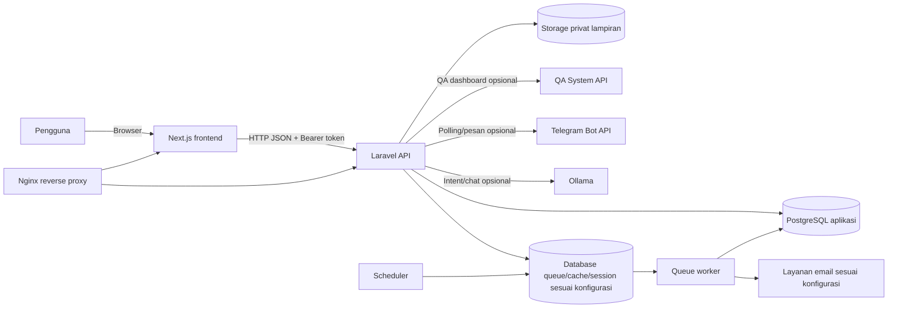
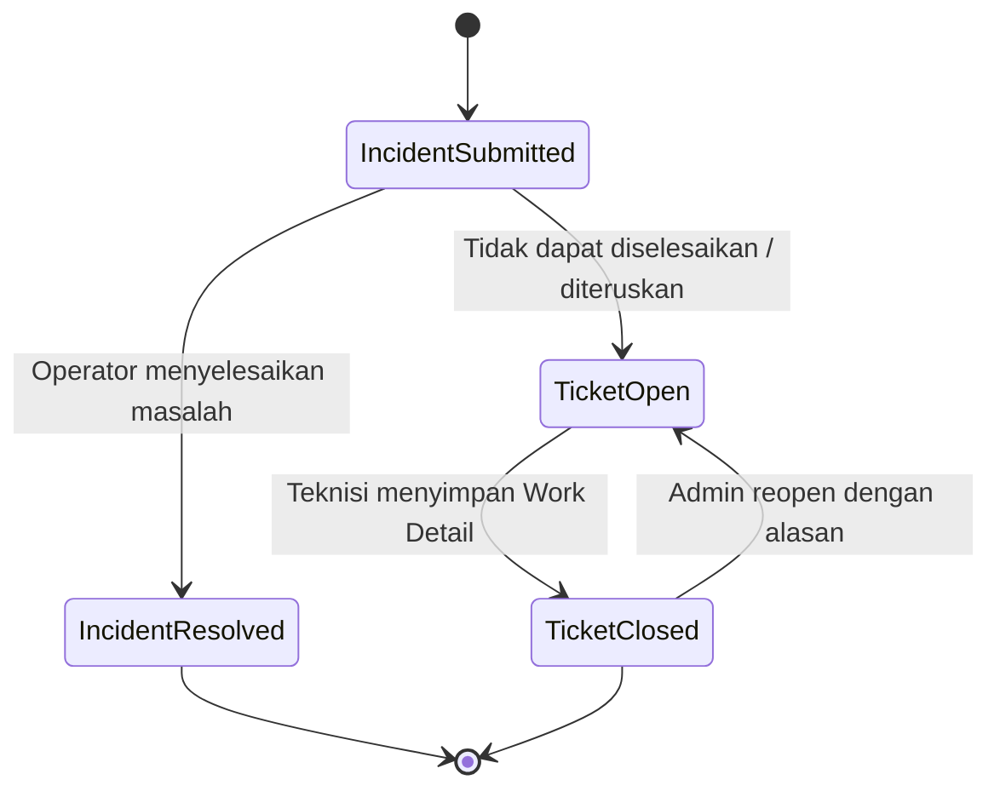
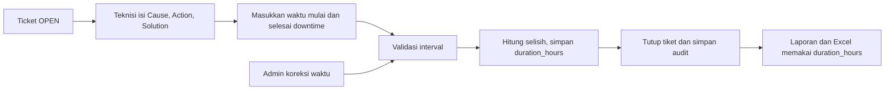
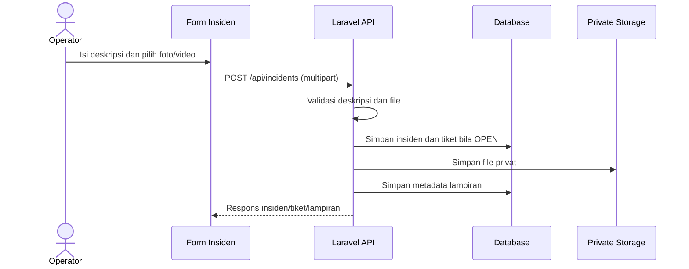
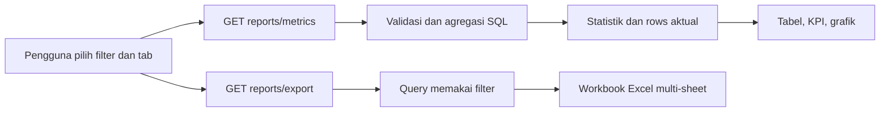
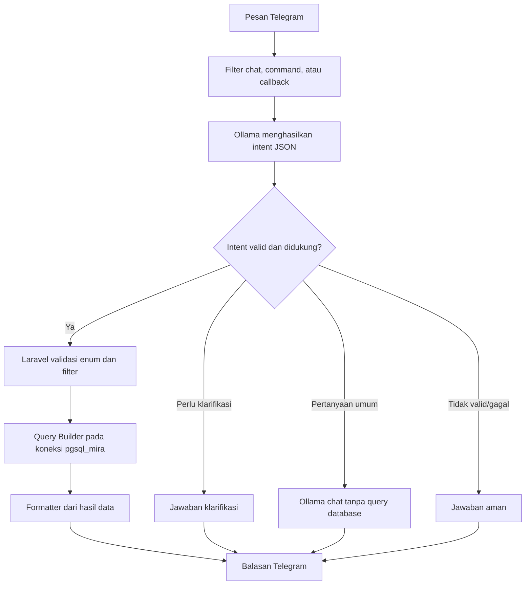
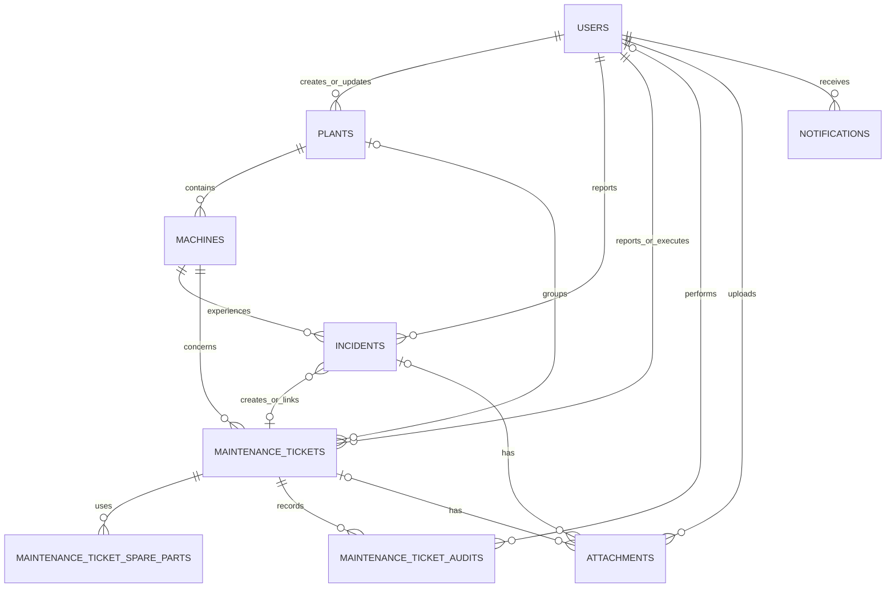

# Maintenance System

Maintenance System adalah aplikasi web untuk menerima laporan gangguan mesin, mengelola tiket perbaikan, mencatat hasil kerja teknisi, serta memantau riwayat dan kinerja maintenance. Aplikasi menghubungkan operator, teknisi, supervisor, QA, dan admin melalui satu alur data.

Sistem membantu tim mengetahui mesin dan plant yang terdampak, memahami kondisi kerusakan sebelum perbaikan, menugaskan tindak lanjut, mencatat downtime berdasarkan pekerjaan aktual, dan meninjau hasil melalui dashboard serta ekspor Excel.

**Fitur utama:** laporan insiden dengan foto/video wajib, tiket maintenance, Work Detail, master plant dan mesin, spare part, audit perubahan waktu downtime, notifikasi, dashboard, laporan multi-sheet Excel, dashboard QA terintegrasi, serta asisten Telegram MIRA yang opsional.

**Stack:** Next.js dan React dengan TypeScript di frontend; Laravel 12 dan PHP di backend; PostgreSQL sebagai database aplikasi pada deployment Compose; Laravel Sanctum untuk token API; penyimpanan lokal privat untuk lampiran; Docker, Nginx, Telegram Bot API, dan Ollama untuk deployment/integrasi terkait.

> Nama aplikasi pada dokumentasi ini adalah **Maintenance System**. MIRA merupakan nama asisten yang tersedia melalui integrasi Telegram.

## Daftar Isi

- [Fitur](#fitur)
- [Teknologi](#teknologi)
- [Arsitektur Sistem](#arsitektur-sistem)
- [Struktur Direktori](#struktur-direktori)
- [Alur Bisnis](#alur-bisnis)
  - [Siklus Tiket Maintenance](#siklus-tiket-maintenance)
  - [Work Detail](#work-detail)
  - [Downtime](#downtime)
  - [Lampiran Foto dan Video](#lampiran-foto-dan-video)
  - [Laporan dan Ekspor](#laporan-dan-ekspor)
  - [Telegram MIRA dan AI](#telegram-mira-dan-ai)
- [Gambaran Database](#gambaran-database)
- [Peran dan Akses](#peran-dan-akses)
- [Prasyarat](#prasyarat)
- [Instalasi dan Pengembangan Lokal](#instalasi-dan-pengembangan-lokal)
- [Konfigurasi Environment](#konfigurasi-environment)
- [Docker dan Deployment](#docker-dan-deployment)
- [Referensi API](#referensi-api)
- [Pengujian dan Quality Assurance](#pengujian-dan-quality-assurance)
- [Troubleshooting](#troubleshooting)
- [Praktik Keamanan](#praktik-keamanan)
- [Kontribusi](#kontribusi)
- [Pengembangan Lanjutan](#pengembangan-lanjutan)
- [Catatan Akurasi dan Batasan](#catatan-akurasi-dan-batasan)

## Fitur

| Modul | Fungsi | Pengguna utama | Status |
| --- | --- | --- | --- |
| Laporan insiden | Memilih plant dan mesin, menjelaskan kondisi awal/lokasi kerusakan, memilih jenis masalah, dan melampirkan minimal satu foto atau video sebelum perbaikan. Insiden OPEN membuat tiket terkait. | Operator | Tersedia |
| Tiket maintenance | Mencari dan memfilter tiket berdasarkan nomor, mesin, plant, status, atau prioritas; melihat detail dan riwayat pekerjaan. | Teknisi, supervisor, QA, admin | Tersedia |
| Work Detail | Mencatat Cause, Action, Executor, waktu mulai/selesai downtime, dan Solution. Durasi dihitung dari rentang waktu. | Teknisi | Tersedia |
| Koreksi waktu dan audit | Admin dapat mengoreksi waktu downtime dengan alasan; nilai sebelum/sesudah tersimpan pada audit tiket. Admin juga dapat membuka kembali tiket CLOSED. | Admin | Tersedia |
| Mesin dan plant | Mengelola data master dan status aktif; data historis dipertahankan dengan menonaktifkan entitas yang telah digunakan. | UI membatasi menu berdasar role; pemeriksaan server berbeda per endpoint | Tersedia |
| Spare part | Menambah atau menghapus catatan pemakaian spare part pada tiket OPEN. | Teknisi | Tersedia |
| Lampiran | Menyimpan foto/video privat, menampilkan preview, dan mengunduh melalui endpoint terlindungi. | Pelapor, teknisi, admin sesuai relasi | Tersedia |
| Dashboard dan laporan | Ringkasan tiket, insiden, mesin, plant, spare part, dan downtime; tersedia ekspor workbook Excel multi-sheet. | Supervisor, QA, admin untuk laporan | Tersedia |
| Notifikasi | Pemberitahuan dalam aplikasi untuk tiket baru/ditutup; pengguna dapat membaca satu atau semua notifikasi. | Pengguna terautentikasi | Tersedia |
| Dashboard QA | Mengambil data mesin dan indikator mutu dari QA System melalui API eksternal. | QA dan pengguna sesuai navigasi | Tersedia jika integrasi dikonfigurasi |
| Telegram MIRA | Menu Telegram, pencarian ringkas data maintenance, dan tanya jawab melalui Ollama. | Chat Telegram yang diizinkan konfigurasi | Opsional; memerlukan layanan eksternal |

PDF export dan unggah publik tidak ditemukan pada implementasi laporan saat ini. Ekspor laporan yang tersedia adalah Excel `.xlsx`.

## Teknologi

| Area | Teknologi yang diverifikasi | Peran |
| --- | --- | --- |
| Frontend | Next.js `^16.3.6`, React `^19.1.0`, TypeScript `^5.0.0`, Tailwind CSS `^4.1.0` | UI, routing halaman, chart, autentikasi sisi klien, dan konsumsi API. |
| Backend | PHP `^8.2` (Dockerfile memakai PHP `8.4`), Laravel `^12.0`, Sanctum `^4.0` | REST API, validasi, authorization, query laporan, job, dan notifikasi. |
| Database | PostgreSQL pada Compose deployment; SQLite in-memory untuk test PHPUnit | Data aplikasi; SQLite dipakai di konfigurasi suite test. |
| UI dan visualisasi | `lucide-react`, Apache ECharts (`echarts`, `echarts-for-react`) | Ikon dan visualisasi dashboard/laporan. |
| Infrastruktur | Docker, Docker Compose, Nginx, PHP-FPM | Menjalankan frontend, API, worker, scheduler, dan reverse proxy. |
| Integrasi | Telegram Bot API, Ollama, QA System API | Bot opsional, pengenalan intent/chat, dan dashboard QA eksternal. |
| Pengujian dan format | PHPUnit `^11.5.50`, Laravel Pint, ESLint 9, TypeScript compiler | Test backend, format PHP, lint, dan pemeriksaan tipe frontend. |

> Versi dependency di atas dibaca dari manifest. Gunakan `frontend/package-lock.json` dan `backend/composer.lock` untuk versi dependency yang terkunci.

## Arsitektur Sistem



- **Frontend** (`frontend/`) memakai Next.js App Router untuk halaman operasional dan request API. URL API dan path dasar dapat dikonfigurasi melalui environment frontend.
- **Backend** (`backend/`) menangani autentikasi token, validasi, authorization, pembuatan tiket dari insiden OPEN, laporan, serta akses file.
- **Database** menyimpan entitas bisnis dan metadata file. Compose deployment tidak menyediakan database sendiri; backend menghubungkan PostgreSQL yang disediakan infrastruktur.
- **Lampiran** berada pada disk Laravel `local` di `storage/app/private`; tabel `attachments` menyimpan metadata dan relasi file. Akses file melewati API dengan pemeriksaan hak akses.
- **Layanan eksternal** QA API, Ollama, Telegram, dan SMTP tidak wajib untuk fungsi inti maintenance.
- **Worker dan scheduler** berjalan sebagai service terpisah untuk queue dan laporan bulanan terjadwal.

## Struktur Direktori

```text
.
├── backend/
│   ├── app/Http/Controllers/  # Controller API dan validasi/authorization
│   ├── app/Http/Resources/   # Transformasi respons API
│   ├── app/Jobs/             # Job laporan maintenance bulanan
│   ├── app/Models/           # Model Eloquent dan relasi
│   ├── app/Services/         # Pembuatan tiket, ekspor, MIRA, QR
│   ├── app/Events/           # Event tiket dibuat/ditutup
│   ├── app/Listeners/        # Pengiriman notifikasi
│   ├── app/Console/Commands/ # Perintah Telegram dan pemeriksaan MIRA
│   ├── config/               # Database, queue, mail, dan service
│   ├── database/migrations/  # Perubahan schema dan relasi
│   ├── database/seeders/     # Akun demo untuk pengembangan
│   ├── routes/api.php        # Endpoint API
│   ├── routes/console.php    # Scheduler dan Artisan command
│   ├── tests/                # Test unit dan feature
│   ├── Dockerfile
│   ├── composer.json
│   └── .env.example
├── frontend/
│   ├── src/app/              # Route halaman Next.js
│   ├── src/components/       # Komponen UI dan fitur
│   ├── src/lib/              # API client dan tipe TypeScript
│   ├── tests/                # Test Node.js
│   ├── Dockerfile
│   ├── package.json
│   └── .env.example
├── nginx/                    # Konfigurasi reverse proxy/backend
├── docs/                     # Checklist UAT yang tersedia
└── docker-compose.production.yml
```

Untuk menelusuri implementasi, mulai dari `backend/routes/api.php`, controller di `backend/app/Http/Controllers/`, model di `backend/app/Models/`, dan halaman pada `frontend/src/app/(protected)/`.

## Alur Bisnis

### Siklus Tiket Maintenance

1. Operator memilih plant dan mesin, jenis masalah, menjelaskan kondisi awal/lokasi kerusakan, lalu mengunggah minimal satu foto atau video sebelum perbaikan.
2. Insiden `OPEN` membuat tiket terkait melalui `MaintenanceTicketCreator`. Insiden yang diselesaikan operator disimpan sebagai `RESOLVED` tanpa tiket maintenance baru.
3. Teknisi menangani tiket OPEN dan mengisi Work Detail, lampiran tambahan bila diperlukan, analisis gangguan, checklist verifikasi, dan spare part.
4. Saat Work Detail menutup tiket, status menjadi `CLOSED`; `closed_at`/`closed_by_id` diperbarui, insiden terkait OPEN menjadi RESOLVED, dan event notifikasi penutupan diterbitkan.
5. Admin dapat reopen tiket CLOSED. Tiket kembali OPEN dan histori penutupan tidak dihapus; perubahan dicatat pada audit.



Status tiket maintenance adalah `OPEN` dan `CLOSED`. Status insiden adalah `OPEN` dan `RESOLVED`. Reopen adalah transisi Admin dari tiket CLOSED ke OPEN, bukan status terpisah.

### Work Detail

Field Work Detail tersimpan pada `maintenance_tickets`, bukan tabel Work Detail tersendiri:

| Field | Kolom | Perilaku |
| --- | --- | --- |
| Cause | `reason` | Penyebab kerusakan diisi teknisi. |
| Action | `action_taken` | Tindakan perbaikan diisi teknisi. |
| Executor | `executor_id` | Diisi server dari teknisi yang terautentikasi. |
| Waktu mulai/selesai downtime | `actual_downtime_started_at`, `actual_downtime_ended_at` | Diisi pada form pekerjaan atau dikoreksi Admin. |
| Duration | `duration_hours` | Dihitung dari rentang waktu pada alur UI baru dan disimpan dalam jam desimal. |
| Solution | `solution` | Hasil pekerjaan diisi teknisi. |

Saat tiket baru ditutup dari UI, waktu selesai otomatis mengikuti waktu penutupan. Teknisi dapat mengubahnya jika mesin kembali beroperasi pada waktu berbeda. Endpoint masih menerima `duration_hours` untuk kompatibilitas klien lama ketika timestamp aktual belum digunakan.



### Downtime

Downtime pada laporan adalah **durasi perbaikan pada Work Detail**. Untuk tiket dengan timestamp aktual lengkap, sumber nilai laporan adalah `maintenance_tickets.duration_hours`, hasil selisih `actual_downtime_ended_at - actual_downtime_started_at`, dibulatkan ke dua desimal jam. Interval valid minimal 15 menit dan maksimal 1000 jam.

Periode downtime menggunakan tanggal selesai pekerjaan: `actual_downtime_ended_at`, atau `closed_at` untuk tiket legacy tanpa timestamp aktual. Agregat KPI hanya memakai tiket CLOSED dengan Duration positif dan pasangan timestamp lengkap, atau record legacy dengan kedua timestamp kosong. Record dengan hanya satu timestamp tidak dianggap nol dan tidak masuk agregat KPI; record dapat ditampilkan sebagai `BELUM LENGKAP` pada tabel/export. Record legacy ditandai `PERKIRAAN` pada export; waktu mulai perkiraan untuk penyajian dihitung dari `closed_at - duration_hours`, tanpa mengubah nilai Duration tersimpan.

Laporan menghitung total jam, jumlah pekerjaan, rata-rata jam, agregat mesin/plant, dan tren harian atau bulanan. Koreksi Admin menyimpan nilai sebelum/sesudah, alasan, user, dan waktu perubahan di `maintenance_ticket_audits`. Reopen tidak menghapus histori.

### Lampiran Foto dan Video

- Pembuatan insiden mensyaratkan deskripsi kondisi awal/lokasi kerusakan minimal 10 karakter dan setidaknya satu foto/video.
- Maksimal lima lampiran per pengiriman; tipe yang diterima JPG/JPEG, PNG, WEBP, MP4, MOV, dan WEBM. API membatasi setiap file sampai 18 MB dan total upload sampai 18 MB.
- File disimpan pada disk `local` privat, sementara tabel `attachments` mencatat nama, path, MIME type, ukuran, uploader, serta relasi insiden/tiket.
- `GET /api/attachments/{attachment}` mengirim file setelah memeriksa kepemilikan insiden atau akses tiket. Frontend memakai endpoint ini untuk preview dan unduhan.
- Teknisi/admin dapat menambah lampiran pada tiket OPEN sesuai akses endpoint; tiket CLOSED tidak menerima unggahan baru.



### Laporan dan Ekspor

Pengguna laporan memilih rentang tanggal, plant, mesin, kategori, pencarian, dan pengurutan yang tersedia. `GET /api/reports/metrics` memvalidasi filter dan menjalankan query builder SQL di backend. Rentang maksimal lima tahun; batas hari kalender memakai zona `Asia/Jakarta`.

Kategori halaman laporan: **Ringkasan**, **Tiket Maintenance**, **Insiden**, **Mesin & Plant**, **Spare Part**, dan **Downtime**. Hitungan tiket/insiden memakai `created_at`; tiket selesai memakai `closed_at`; downtime memakai tanggal selesai pekerjaan sebagaimana definisi di atas. Filter plant/mesin menggunakan relasi ticket atau machine sesuai query kategori.

`GET /api/reports/export` menghasilkan workbook `.xlsx` multi-sheet: Ringkasan, Tiket Maintenance, Insiden, Mesin & Plant, Spare Part, dan Downtime. Ringkasan memuat definisi KPI; chart worksheet ringkasan disertakan bila ada data positif. Export membutuhkan ekstensi PHP `zip`.



### Telegram MIRA dan AI

Integrasi ini opsional. Service `maintenance-telegram` melakukan long polling ke Telegram Bot API dan memproses pesan teks maupun callback menu. Di grup, hanya chat ID terkonfigurasi dan pesan yang menyebut username bot diproses; grup lain diabaikan. `/start` dan `/menu` menampilkan menu ringkasan, tiket, insiden, mesin/plant, spare part, serta tanya MIRA.



Untuk pertanyaan maintenance, Ollama hanya mengusulkan intent JSON dengan entitas, metrik, periode, filter, dan limit terbatas. Laravel memvalidasi intent lalu menjalankan query tetap di koneksi `pgsql_mira`; output model tidak dieksekusi sebagai SQL. Formatter membentuk jawaban dari hasil query. Pertanyaan umum dapat dijawab model tanpa query database; sapaan tertentu dijawab langsung. Gunakan akun DB MIRA read-only dengan hak minimum. Autentikasi akun Telegram per role untuk private chat belum tersedia; batasi token dan akses chat sesuai kebijakan organisasi.

#### Dashboard QA dan laporan email bulanan

Dashboard QA memanggil QA System API menggunakan token konfigurasi atau login service account, lalu menyimpan token sementara pada file cache. Fitur memerlukan endpoint dan kredensial eksternal. Tanpa konfigurasi, layanan QA mengembalikan status tidak tersedia.

Job `GenerateMonthlyMaintenanceReport` dijadwalkan tanggal 1 pukul 00:05 melalui `schedule:work`. Job menghitung durasi tiket tertutup dan persentase terhadap jam produksi teoritis (`jumlah mesin × hari pada bulan × jam produksi per mesin per hari`), lalu mengirim email kepada penerima yang dikonfigurasi. Nilai jam produksi dan penerima perlu diatur. Basis tanggal job ini adalah `closed_at`, berbeda dari filter Downtime halaman Laporan.

## Gambaran Database



| Entitas | Tujuan | Relasi utama |
| --- | --- | --- |
| `users` | Akun dan role pengguna. | Reporter, executor, auditor, uploader, creator/updater master data, penerima notifikasi. |
| `plants` | Master plant. | Memiliki banyak mesin; dapat direlasikan ke tiket. |
| `machines` | Master mesin, plant, section, dan status aktif. | Dimiliki plant; terkait insiden dan tiket. |
| `incidents` | Laporan gangguan. | Terkait plant, mesin, pelapor; dapat terkait tiket dan lampiran. |
| `maintenance_tickets` | Alur maintenance dan Work Detail. | Terkait plant/mesin/pelapor/executor; memiliki spare part, lampiran, audit. |
| `maintenance_ticket_spare_parts` | Pemakaian spare part per tiket. | Anak tiket maintenance. |
| `maintenance_ticket_audits` | Riwayat reopen dan koreksi downtime. | Action, alasan, user, before/after JSON, tiket. |
| `attachments` | Metadata file dan relasi storage privat. | Terhubung ke insiden dan/atau tiket, serta uploader. |
| `notifications` | Notifikasi Laravel. | Polymorphic ke notifiable, dipakai untuk user. |
| `personal_access_tokens` | Token Laravel Sanctum. | Polymorphic ke pemilik token. |

Cache, session, queue, dan failed job dapat memakai tabel database Laravel sesuai konfigurasi. Rincian kolom ada pada migration di `backend/database/migrations/`.

## Peran dan Akses

Endpoint API kecuali login berada dalam grup `auth:sanctum`. UI menyaring menu berdasar role, dan controller menerapkan pemeriksaan tambahan pada operasi sensitif.

| Role | Kemampuan utama yang tampak pada implementasi |
| --- | --- |
| `operator` | Membuat insiden; membaca insiden milik sendiri; mengakses lampiran insiden milik sendiri; menerima notifikasi. |
| `technician` | Mengerjakan/menutup tiket, Work Detail, spare part, dan lampiran tiket OPEN. UI juga menampilkan menu mesin, tetapi `MachineController` tidak menerapkan pemeriksaan role pada operasi tulis. |
| `supervisor` | Mengakses laporan/dashboard dan tiket pemantauan melalui UI. |
| `qa` | Mengakses laporan dan dashboard QA; melihat data maintenance sesuai UI. |
| `admin` | Mengelola user/plant, mengoreksi waktu downtime, reopen tiket, melihat audit, dan laporan. |

Beberapa route memakai autentikasi tanpa pemeriksaan role eksplisit pada controller. Contohnya operasi tulis mesin dan endpoint dashboard QA/maintenance tidak menunjukkan pemeriksaan role tambahan; daftar tiket juga terbuka untuk setiap user terautentikasi. Jangan menganggap menu yang disembunyikan frontend sebagai pembatas API. Tinjau dan perketat aturan akses sebelum deployment sesuai kebijakan organisasi.

## Prasyarat

- Git.
- PHP `8.2+` sesuai `backend/composer.json`; Dockerfile backend memakai PHP `8.4` dan memasang `pdo_pgsql`, `intl`, `zip`, `pcntl`.
- Composer 2.
- Node.js 22 (image frontend) dan npm.
- PostgreSQL untuk pengembangan yang merepresentasikan deployment. Database harus tersedia sebelum migration.
- Ekstensi PHP `pdo_pgsql` dan `zip` untuk PostgreSQL dan ekspor Excel. Image backend memasang keduanya.
- Docker Engine dan Docker Compose plugin untuk deployment container.
- Ollama, Telegram bot, QA System API, atau SMTP hanya untuk integrasi terkait.

## Instalasi dan Pengembangan Lokal

Repository tidak menyediakan Compose khusus development. Jalankan backend dan frontend secara terpisah.

1. Clone repository:

   ```bash
   git clone <url-repository>
   cd maintenance
   ```

2. Siapkan backend:

   ```bash
   cd backend
   composer install
   cp .env.example .env
   php artisan key:generate
   ```

   Atur koneksi PostgreSQL development pada `backend/.env` (`DB_CONNECTION`, `DB_HOST`, `DB_PORT`, `DB_DATABASE`, `DB_USERNAME`, `DB_PASSWORD`). Database harus sudah dibuat. Jangan gunakan kredensial production. Sebagian suite test memakai SQLite in-memory; aplikasi end-to-end lebih sesuai diuji dengan PostgreSQL karena query memakai sintaks seperti `ILIKE`.

3. Jalankan migration dan seeder hanya pada database lokal yang disiapkan untuk pengembangan:

   ```bash
   php artisan migrate --seed
   ```

   Seeder membuat akun demo untuk role operator, technician, supervisor, QA, dan admin. Kredensial demo ditetapkan di `backend/database/seeders/DatabaseSeeder.php`; jangan gunakan akun tersebut di lingkungan bersama/production. Seeder tidak membuat plant/mesin.

4. Jalankan backend:

   ```bash
   php artisan serve --host=127.0.0.1 --port=8000
   ```

5. Di terminal lain siapkan frontend:

   ```bash
   cd frontend
   npm ci
   cp .env.example .env.local
   ```

   Pastikan `NEXT_PUBLIC_API_URL=http://localhost:8000`. Restart Next dev server setelah mengubah environment.

6. Jalankan frontend:

   ```bash
   npm run dev
   ```

   Buka alamat yang ditampilkan Next.js (umumnya `http://localhost:3000`). Laravel menyediakan health endpoint `/up`.

7. Buat plant dan mesin dari UI/API setelah login admin atau isi data development melalui proses lokal yang disetujui. Jangan menyalin data operasional tanpa izin.

## Konfigurasi Environment

Simpan `.env`, `.env.local`, dan secret di luar commit. File contoh bukan konfigurasi lengkap deployment; default Laravel berada pada `backend/config/`.

### Frontend

| Variabel | Fungsi |
| --- | --- |
| `NEXT_PUBLIC_API_URL` | Base URL Laravel API; wajib untuk API client. |
| `NEXT_PUBLIC_BASE_PATH` | Prefix URL Next.js; Compose membangun app di bawah `/mira`, lokal umumnya kosong. |
| `NEXT_PUBLIC_*_PATH` | Override path auth, ticket, machine, incident, QA, dashboard, notification, analytics, dan report. Harus cocok dengan route Laravel. |
| `NEXT_PUBLIC_VAPID_PUBLIC_KEY` | Public key untuk push bila dikonfigurasi; bukan private key. |

Override yang tercantum pada `frontend/.env.example` mencakup `NEXT_PUBLIC_AUTH_*`, `NEXT_PUBLIC_MACHINES_PATH`, template path mesin/tiket, `NEXT_PUBLIC_INCIDENTS_CREATE_PATH`, `NEXT_PUBLIC_TICKETS_*`, `NEXT_PUBLIC_NOTIFICATIONS_*`, `NEXT_PUBLIC_PUSH_SUBSCRIPTION_PATH`, `NEXT_PUBLIC_QA_*`, `NEXT_PUBLIC_OPERATIONS_*`, `NEXT_PUBLIC_SUPERVISOR_OVERVIEW_PATH`, `NEXT_PUBLIC_REPORTS_*`, dan `NEXT_PUBLIC_MACHINE_ANALYTICS_PATH_TEMPLATE`. Nilai kosong menggunakan default path dalam modul frontend bila tersedia.

### Backend

| Kelompok | Variabel penting | Keterangan |
| --- | --- | --- |
| Laravel | `APP_NAME`, `APP_ENV`, `APP_KEY`, `APP_DEBUG`, `APP_URL`, `FRONTEND_URL` | Identitas, key, debug, URL, dan origin CORS. Debug nonaktif di deployment. |
| Database | `DB_CONNECTION`, `DB_HOST`, `DB_PORT`, `DB_DATABASE`, `DB_USERNAME`, `DB_PASSWORD`, `DB_URL` | Koneksi database aplikasi. Compose mengatur driver PostgreSQL dan host melalui environment/container network. |
| Storage/queue | `FILESYSTEM_DISK`, `QUEUE_CONNECTION`, `MAINTENANCE_REPORT_QUEUE_CONNECTION`, `MAINTENANCE_REPORT_QUEUE` | Disk default serta koneksi/queue laporan email. |
| Email bulanan | `MAIL_MAILER`, `MAIL_HOST`, `MAIL_PORT`, `MAIL_USERNAME`, `MAIL_PASSWORD`, `MAIL_FROM_ADDRESS`, `MAINTENANCE_REPORT_*_EMAIL` | Transport email dan alamat penerima laporan. |
| Ollama | `OLLAMA_URL`, `OLLAMA_MODEL`, `OLLAMA_KEEP_ALIVE` | Endpoint Ollama, model terpasang, dan keep-alive. |
| Telegram | `TELEGRAM_BOT_TOKEN`, `TELEGRAM_BOT_USERNAME`, `TELEGRAM_MAINTENANCE_CHAT_ID` | Token, mention bot, dan chat grup yang diizinkan. Jangan publish nilainya. |
| Query MIRA | `MIRA_DB_HOST`, `MIRA_DB_PORT`, `MIRA_DB_DATABASE`, `MIRA_DB_USERNAME`, `MIRA_DB_PASSWORD`, `MIRA_DB_CHARSET`, `MIRA_DB_SSLMODE` | Koneksi `pgsql_mira`; gunakan akun read-only dan jangan mengandalkan default host pada source. |
| QA System | `QA_SYSTEM_API_URL`, `QA_SYSTEM_API_TOKEN`, `QA_SYSTEM_SERVICE_EMAIL`, `QA_SYSTEM_SERVICE_PASSWORD`, `QA_SYSTEM_DEVICE_NAME`, `QA_SYSTEM_TOKEN_TTL` | API dan service account eksternal untuk dashboard QA. Simpan credential di secret manager/environment aman. |
| Jam produksi email | `MAINTENANCE_PRODUCTION_HOURS_PER_MACHINE_PER_DAY` | Jam produksi per mesin per hari; harus positif agar job bulanan dapat berjalan. |

Variabel Laravel generik lain mengikuti `backend/config/database.php`, `queue.php`, `mail.php`, `filesystems.php`, dan `session.php`. Jangan menaruh secret di issue, log, atau dokumentasi.

## Docker dan Deployment

`docker-compose.production.yml` adalah konfigurasi deployment, bukan stack mandiri developer. Service yang didefinisikan:

| Service | Fungsi |
| --- | --- |
| `maintenance-backend` | Laravel PHP-FPM. |
| `maintenance-backend-migrations` | Menjalankan `php artisan migrate --force`; memakai image backend dan volume storage. |
| `maintenance-backend-web` | Nginx API Laravel dan health check `/up`. |
| `maintenance-frontend` | Next standalone server; dibangun dengan base path `/mira` dan API path `/mira/api`. |
| `maintenance-queue` | Worker queue Laravel. |
| `maintenance-scheduler` | `php artisan schedule:work`. |
| `maintenance-telegram` | Long polling bot opsional yang memerlukan konfigurasi Telegram/Ollama/MIRA. |

Compose merujuk `backend/.env`, volume `maintenance-backend-storage`, dan external networks `qa-system-network` serta `rapidplast-network`. Network dan database PostgreSQL harus tersedia dari infrastruktur; Compose tidak membuat service database. `nginx/maintenance-location.conf` meneruskan `/mira/` ke Next.js dan `/mira/api/` ke Laravel; `nginx/backend.conf` meneruskan PHP ke PHP-FPM.

Port host dapat diatur melalui `MAINTENANCE_FRONTEND_PORT` dan `MAINTENANCE_BACKEND_PORT`; mapping pada Compose terikat ke localhost. Jangan membuka port ke jaringan publik tanpa perimeter yang sesuai.

Contoh inspeksi setelah prasyarat infrastruktur disiapkan:

```bash
docker compose -f docker-compose.production.yml config
docker compose -f docker-compose.production.yml ps
docker compose -f docker-compose.production.yml logs --tail=100 maintenance-backend-web
docker compose -f docker-compose.production.yml logs --tail=100 maintenance-queue
```

Compose dapat membangun image dari checkout, tetapi registry/tag release, backup, persetujuan, rollback, dan penyediaan network/database eksternal tidak didefinisikan repository. Ikuti runbook platform; dokumentasi ini tidak menjalankan deployment.

## Referensi API

Semua endpoint kecuali `POST /api/login` berada di grup `auth:sanctum`. Client memakai Bearer token. Route diverifikasi dari `backend/routes/api.php` dan `php artisan route:list --path=api`.

| Method | Path | Fungsi | Akses khusus |
| --- | --- | --- | --- |
| `POST` | `/api/login` | Login dan menerbitkan Sanctum token. | Publik; akun harus aktif. |
| `GET` | `/api/me` | Informasi user saat ini. | Autentikasi. |
| `POST` | `/api/logout` | Menghapus token aktif. | Autentikasi. |
| `GET`, `POST` | `/api/incidents` | Daftar (non-admin hanya milik sendiri) / buat insiden. | Auth; pembuatan butuh deskripsi dan media. |
| `GET`, `PUT/PATCH`, `DELETE` | `/api/incidents/{incident}` | Baca, ubah, hapus insiden. | Owner atau admin untuk detail/perubahan. |
| `POST` | `/api/incidents/{incident}/attachments` | Tambah lampiran insiden. | Pelapor atau admin. |
| `GET`, `POST` | `/api/tickets` | Daftar/filter atau buat tiket. | Auth; pembuatan teknisi. |
| `GET`, `PUT/PATCH`, `DELETE` | `/api/tickets/{ticket}` | Detail, ubah, hapus tiket. | Auth; route binding memakai nomor tiket. |
| `POST` | `/api/tickets/{ticket}/actions/close` | Work Detail dan penutupan. | Teknisi. |
| `POST` | `/api/tickets/{ticket}/reopen` | Reopen CLOSED dengan alasan. | Admin. |
| `PUT` | `/api/tickets/{ticket}/downtime-times` | Koreksi waktu downtime dan simpan audit. | Admin. |
| `POST`, `DELETE` | `/api/tickets/{ticket}/spare-parts[/{sparePart}]` | Catat/hapus spare part. | Teknisi; tiket OPEN. |
| `POST` | `/api/tickets/{ticket}/attachments` | Lampiran tiket. | Teknisi/admin; tiket OPEN. |
| `GET` | `/api/attachments/{attachment}` | Stream file setelah authorization. | Admin, pemilik insiden, atau akses tiket yang diizinkan. |
| `GET` | `/api/reports/metrics` | KPI, grafik, dan tabel terfilter. | Supervisor, QA, admin. |
| `GET` | `/api/reports/export` | Ekspor workbook `.xlsx`. | Supervisor, QA, admin. |
| `GET`, `POST`, `PUT/PATCH`, `DELETE` | `/api/machines[/{machine}]` | Daftar dan kelola mesin. | Auth saja pada controller saat ini; UI membatasi menu, tetapi server tidak menunjukkan role guard pada operasi tulis. Delete menonaktifkan. |
| `POST` | `/api/machines/resolve-qr` | Resolve payload QR ke mesin aktif dan plant. | Auth. |
| `GET`, `POST`, `PUT/PATCH`, `DELETE` | `/api/plants[/{plant}]` | Daftar/kelola plant. | Write admin; delete menonaktifkan. |
| `GET` | `/api/maintenance-dashboard` | Ringkasan operasional maintenance. | Auth. |
| `GET` | `/api/qa-dashboard` | Proxy data QA System. | Auth; service account eksternal. |
| `GET`, `POST`, `PUT` | `/api/admin/users[/{user}]` | Daftar, buat, dan ubah user. | Admin. |
| `GET`, `PATCH` | `/api/notifications`, `/api/notifications/{notification}/read`, `/api/notifications/read-all` | Baca notifikasi. | Auth; scope ke user login. |
| `GET` | `/api/notifications/unread-count` | Jumlah notifikasi belum dibaca. | Auth. |

Resource ticket juga mendaftarkan update/delete. Periksa controller dan `route:list` setelah perubahan source untuk aturan terbaru.

## Pengujian dan Quality Assurance

Jalankan dari direktori yang ditunjukkan. PHPUnit memakai SQLite in-memory pada `backend/phpunit.xml`.

```bash
# Backend
cd backend
php artisan test
vendor/bin/pint --test

# Frontend
cd ../frontend
npm test
npm run lint
npm run typecheck
npm run build
```

Test backend ada di `backend/tests/Feature/` (insiden, tiket, downtime, laporan, lampiran, ownership, user, notifikasi, Telegram) dan `backend/tests/Unit/` (query, intent, formatter, assistant MIRA). Test frontend berbasis Node.js berada di `frontend/tests/`.

Pemeriksaan route dan scheduler:

```bash
cd backend
php artisan route:list --path=api
php artisan schedule:list
```

## Troubleshooting

| Gejala | Pemeriksaan aman |
| --- | --- |
| Composer/npm gagal memasang dependency | Periksa versi PHP/Node, koneksi registry, dan lockfile. Gunakan `composer install` dari `backend/`, `npm ci` dari `frontend/`. |
| `NEXT_PUBLIC_API_URL is not configured` | Pastikan `frontend/.env.local` ada dan URL API ditetapkan; restart dev server setelah ubah env. |
| API 401 | Login kembali dan periksa token sesi browser; token invalid memicu session expired. |
| API 403 | Periksa role dan endpoint/controller. Menu tersembunyi bukan kontrol authorization. |
| Database gagal diakses | Periksa `DB_CONNECTION`, host/port, nama DB, user/password, network, dan status PostgreSQL. Compose bergantung external network dan DB. |
| Migration gagal | Periksa `php artisan migrate:status`, koneksi, dan `backend/storage/logs/laravel.log`. Tinjau perubahan sebelum menjalankan pada data non-lokal. |
| Upload/preview lampiran gagal | Periksa limit Nginx/PHP, tipe/ukuran, izin volume `storage`, metadata, dan hak akses. Jangan pindahkan file ke direktori publik. |
| Ekspor Excel gagal | Pastikan ekstensi PHP `zip` aktif dan query dapat membaca DB; cek log backend, kategori, dan filter. |
| QA dashboard 503 | Periksa URL API, token/service account, konektivitas jaringan, dan masa berlaku credential. |
| MIRA tidak merespons | Periksa service bot, token, log, Telegram, model di Ollama, URL endpoint, dan koneksi DB read-only MIRA. Hindari dua polling process untuk satu token. |
| Queue/email laporan tidak terkirim | Periksa worker, scheduler, `QUEUE_CONNECTION`, SMTP, jam produksi positif, penerima valid, dan `php artisan schedule:list`. |
| Compose gagal start | Validasi dengan `docker compose -f docker-compose.production.yml config`; periksa external networks, env file, serta log service. File ini tidak menyediakan DB. |

## Praktik Keamanan

- Jangan commit `.env`, `.env.local`, token, password, private VAPID key, atau export dengan data operasional.
- Gunakan `APP_DEBUG=false` dan `APP_KEY` unik di luar development; simpan secret lewat secret manager/environment deployment.
- Terapkan authorization di backend. Review policy/controller saat menambah endpoint data insiden, tiket, user, dan lampiran.
- Gunakan akun database read-only terpisah untuk MIRA dan hak minimum untuk QA/API.
- Pertahankan storage lampiran privat, pemeriksaan akses, batas tipe/ukuran/jumlah, dan validasi input.
- Hindari menulis credential, token, payload media, atau data sensitif pada log. Rotasi secret bila terekspos.
- Rencanakan backup database dan volume lampiran bersama-sama agar metadata dan file tetap konsisten.
- Review migration dan dampaknya sebelum menjalankan pada deployment. Service migration Compose menjalankan `migrate --force` saat dimulai.

## Kontribusi

Repository belum mendefinisikan branch naming, commit convention, atau template Pull Request. Alur berikut merupakan rekomendasi:

1. Buat branch dari branch dasar yang ditentukan tim.
2. Implementasikan perubahan dengan mempertahankan kontrak API dan authorization backend.
3. Tambahkan/perbarui test untuk perilaku, validasi, dan authorization.
4. Jalankan test, formatter/linter, typecheck, dan build yang relevan.
5. Buat commit dengan ringkasan yang jelas.
6. Ajukan Pull Request dengan konteks, dampak data, langkah uji, dan screenshot bila mengubah UI.

Perubahan schema perlu migration serta pertimbangan data lama/rollback. Jangan mengandalkan perubahan langsung pada database deployment.

## Pengembangan Lanjutan

Rekomendasi berdasarkan gap audit, bukan klaim fitur saat ini:

- Menambahkan policy role yang konsisten untuk semua endpoint baca/tulis, termasuk memperjelas scope list tiket dan dashboard.
- Melengkapi environment example per konteks tanpa nilai rahasia.
- Menambahkan runbook deployment/rollback dan Compose development yang tidak bergantung pada network eksternal.
- Menambahkan autentikasi/allowlist role untuk interaksi Telegram private chat.
- Menambahkan pemeriksaan integritas periodik antara file storage dan metadata serta kebijakan backup/retensi.
- Menambahkan pemeriksaan Markdown/Mermaid pada CI jika pipeline repository dibangun.

## Catatan Akurasi dan Batasan

- Root repository sebelumnya tidak memiliki `README.md`; dokumen ini ditulis dari source/configuration yang tersedia. `backend/README.md` masih merupakan template Laravel.
- Repository tidak mendefinisikan PostgreSQL service lokal, CI workflow, registry image, tahapan deployment/rollback, maupun kebijakan backup. Detail tersebut perlu diperoleh dari tim/platform.
- `backend/.env.example` tidak mencantumkan seluruh variabel backend. Environment deployment harus mengikuti konfigurasi dan secret manager platform.
- Seeder membuat akun demo tetapi tidak membuat plant/mesin. Database baru tidak otomatis memiliki master atau data laporan.
- Laporan downtime mendukung record legacy yang hanya memiliki `duration_hours`; periode memakai `closed_at` pada record tersebut. Waktu perkiraan untuk tampilan/export tidak mengubah durasi tersimpan.
- Test memakai SQLite in-memory, sedangkan deployment menggunakan PostgreSQL dan beberapa query memakai sintaks PostgreSQL. Test tidak menggantikan verifikasi integrasi PostgreSQL.
